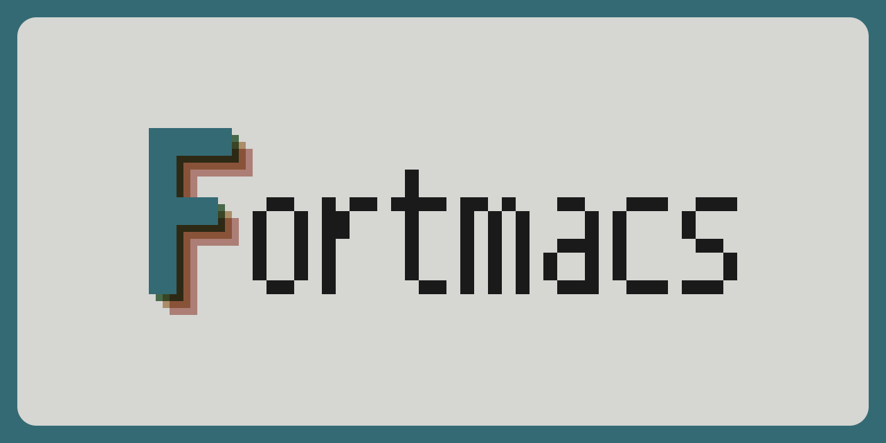

<h1 align="center"></h1>

GNU Emacs 31.1 rewritten in modern Fortran (2018+), for Linux on x86-64 and
aarch64. There is no Elisp: your configuration is a Fortran module compiled
into the binary, and every rebuild is a numbered generation you can roll
back to, as in Guix.

<!-- progress:start -->
**Progress:** early porting. Fortmacs runs as a bare-bones terminal editor; most of Emacs is still
missing. See [PORTING.md](PORTING.md) for the roadmap and what works so far.

<picture>
<source media="(prefers-color-scheme: dark)" srcset="docs/progress/pie-dark.svg">

</picture>
<!-- progress:end -->

The project is funded entirely by one person. Every agent run costs tokens,
so token usage and its cost set the pace.

## Building

Requires gfortran ≥ 13 and [fpm](https://fpm.fortran-lang.org); development
also needs [fprettify](https://github.com/fortran-lang/fprettify) 0.3.7 and
[Fortitude](https://fortitude.readthedocs.io) 0.9.2.

```sh
fpm build
fpm run -- FILE         # edit FILE (C-x C-s saves, C-x C-c exits)
tools/check.sh          # format, lint, debug build and tests, as CI runs them
tools/check.sh --fix    # reformat and apply safe lint fixes
```

CI runs the same check on Ubuntu and Fedora (x86-64 and aarch64) and Arch
Linux (x86-64) for every pull request and after each merge, and on Guix
weekly.

## Configuring

Write your configuration in `~/.config/fortmacs/init.f90`
([docs/init.f90](docs/init.f90) is an example): a module `user_config` whose
`configure` subroutine runs at startup. Settings are variables
(`tab_width = 4`), built-in commands are objects
(`commands%upcase_region%disabled = .false.`), and keys are bound with
`keymap_global_set("C-c d", "my_command", status)`.

```sh
fpm install --profile release   # fortmacs, its library and modules, in ~/.local
fortmacs --recompile            # build init.f90 into a new generation
fortmacs -q                     # start without your configuration
fortmacs --list-generations     # every build, the current one marked
fortmacs --rollback             # back to the generation before
fortmacs --switch-generation 3  # or to any generation
```

A failed build shows the compiler's errors and leaves your last good build
running. Each generation is kept with the `init.f90` it was built from in
`~/.local/state/fortmacs/generations`.

## Why Fortran?

1. **Real parallel threads.** Emacs runs one thread at a time under a global
   lock. Fortmacs keeps one thread for buffers and the screen, as Emacs does,
   and will run heavy work (searching large files, file I/O, syntax parsing,
   language servers) on other cores, each worker with its own copy of the
   data. Not implemented yet; see "Threads" in [PORTING.md](PORTING.md).
2. **Fast native code.** Compiled ahead of time by optimizing compilers,
   with no garbage-collection pauses (objects are freed explicitly) and no
   init files to evaluate at startup.
3. **Errors caught at compile time.** Static types, `implicit none` and
   argument intents turn many mistakes into compile errors, in your
   configuration too.
4. **A stable standard.** Fortran is an ISO standard with many independent
   compilers; code from decades ago still compiles.
5. **Syntax.** Blocks say where they end (`end if`, `end do`) instead of
   ending where parentheses balance.
   [Compare the two side by side](https://fortmacs.github.io/Fortmacs/syntax.html).
   That's a preference, not a verdict on Elisp.

6. **Help that speaks Fortran.** Emacs is at its best as an environment for
   the language it's written in: it documents every function and variable,
   shows their current values and jumps to their source. Fortmacs aims to
   bring that to Fortran: help shows Fortran names, values and source files,
   so exploring and configuring the editor feels like working in Fortran.

## Differences from Emacs

Fortmacs behaves like Emacs: the same commands, keys and results, with
Emacs's own tests ported to check it. It is not a 1:1 copy, though: its
names, help and internals are Fortran-first.

- Names use underscores (`M-x find_file`, `C-h v fill_column`,
  `text_mode_hook`), and Lisp terms take Fortran names: defun, sexp and <!-- fortran-names: keep -->
  alist become subprogram, expression and table (`C-M-f` is <!-- fortran-names: keep -->
  `forward_expression`). Keys and mode-line text are unchanged.
  PORTING.md, "Fortran names for Lisp terms", has the full list.
- One word per meaning. Emacs's names grew over forty years, so the same
  idea is spelled several ways; since everything is being rewritten anyway,
  Fortmacs unifies the wording. Running anything is `execute`:
  `call_interactively`, `run_mode_hooks` and `run_with_timer` become <!-- fortran-names: keep -->
  `execute_interactively`, `execute_mode_hooks` and `execute_with_timer`.
  Predicates are `is_*` (`process_live_p` is `is_process_live`), <!-- fortran-names: keep -->
  and internal helpers use one word each: get, not fetch; make, not new; <!-- fortran-names: keep -->
  add, not push or append. Where Emacs gives two words two behaviors, <!-- fortran-names: keep -->
  both stay: kill saves to the kill ring, delete does not. PORTING.md,
  "One word per meaning", has the full list.
- Help shows Fortran values (`.true.`, `8`, `"text"`, named constants) and
  names the Fortran file a definition lives in.
- There is no Lisp to evaluate at run time: no `M-:`, `eval-buffer` or
  `ielm`, and `*scratch*` starts in Fundamental mode. Changing the
  configuration means rebuilding.
- Configuration and packages are Fortran modules compiled into the binary;
  commands that save settings write Fortran into `init.f90`.

## Why AI assistance?

Emacs has tens of thousands of C and Elisp definitions, plus over 7,000
Elisp packages (509 in GNU ELPA, 293 in NonGNU ELPA, 6,333 in MELPA). A
handful of porters could never keep up, and maintainers shouldn't be asked
to port their work to a niche experiment, so without help Emacs in Fortran
would never happen. This is for fun. Let's see where it goes.

AI has made breakthroughs once out of reach: AlphaFold's 200 million
protein structures (part of the 2024 Nobel Prize in Chemistry), the
antibiotic candidate halicin and, according to press reports the CIA has
not confirmed, the 2026 rescue of an airman shot down over Iran, located by
a sensor called "Ghost Murmur" that reportedly uses AI to single out his
heartbeat from the background noise. Yet AI-assisted coding still carries
a stigma. Fortmacs judges its code like any other: it must build, pass
Emacs's own tests and survive human review.

Fortmacs is co-written with Claude Code, Anthropic's coding agent. It needs
constant direction: left alone it drifted toward Lisp written in Fortran,
such as `call put("upcase-region", "disabled", .false., status)` where
Fortmacs now has `commands%upcase_region%disabled = .false.`. It also let
Lisp terms slip into Fortran names unremarked, such as <!-- fortran-names: keep -->
`beginning_of_defun`, `forward_sexp` and `auto_mode_alist`; the renames <!-- fortran-names: keep -->
are recorded in PORTING.md, and a check in CI keeps them from coming
back. In return it:

- reads C, Elisp and Fortran, porting each function with a citation to its
  source and porting Emacs's tests with it;
- applies the conventions consistently across thousands of functions, with
  up to eight agents working in parallel;
- wrote about 65,000 lines of Fortran and tests, not counting generated
  tables, in the first three days; token cost, not typing, sets the pace.

Every change is built, tested and checked for memory leaks in CI on two
architectures, and a human reviews and merges every pull request. GNU Emacs
does not accept AI-generated contributions, so upstream stays a read-only
reference and nothing is sent back to it.

## Reference source

Ports follow GNU Emacs tag `emacs-31.1`. `tools/fetch-upstream.sh` places a
verified shallow checkout in `upstream/emacs/` (git-ignored).

## License

GPLv3 or later, matching upstream; see [LICENSE](LICENSE). Files ported from
GNU Emacs keep the Free Software Foundation copyright notice alongside ours.
